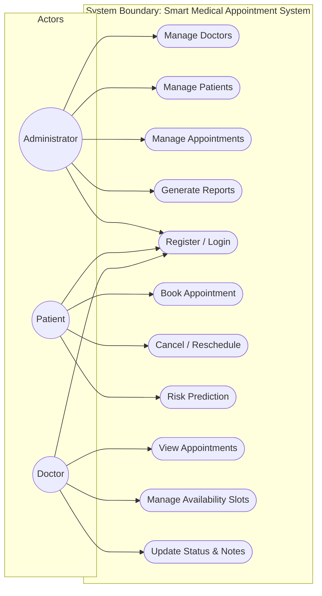
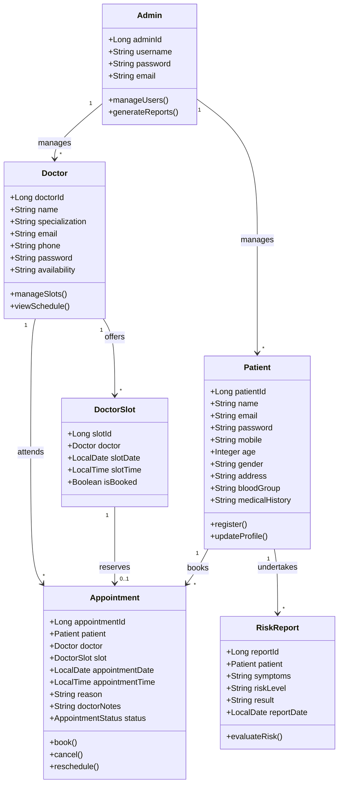
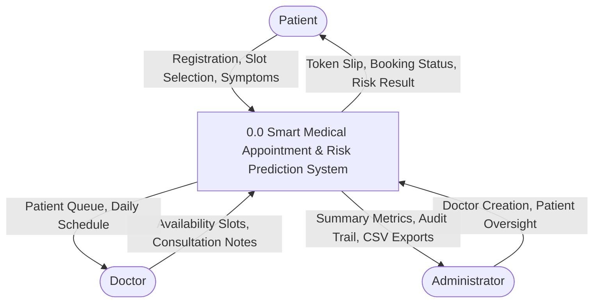
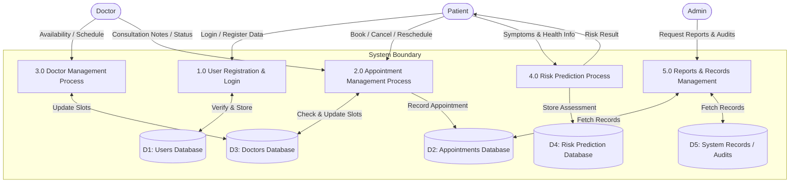
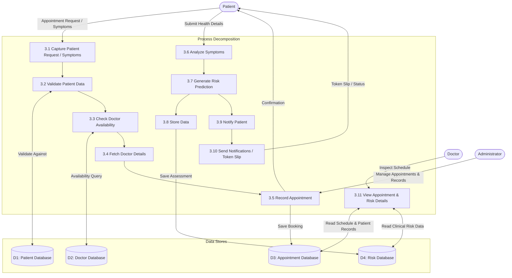
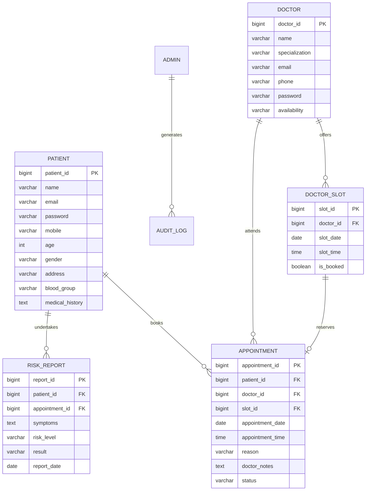

# INDIRA GANDHI NATIONAL OPEN UNIVERSITY (IGNOU)
## School of Computer and Information Sciences (SOCIS)
### Bachelor of Computer Applications (BCA) — Final Year Major Project (BCSP-064)

---

# PROJECT REPORT
# SMART MEDICAL APPOINTMENT AND RISK PREDICTION SYSTEM

**Submitted in partial fulfillment of the requirements for the award of the degree of Bachelor of Computer Applications (BCA)**

- **Student Name:** Preeti
- **Enrollment Number:** 2401048429
- **Course Code:** BCSP-064
- **Project Guide:** Gaurav Dhyani (Cloud Administrator)
- **Academic Year:** 2025–2026
- **Submission Centre:** Indira Gandhi National Open University (IGNOU), New Delhi

---

## CERTIFICATE OF ORIGINALITY

This is to certify that the project entitled **"Smart Medical Appointment and Risk Prediction System"** submitted by **Preeti**, Enrollment Number **2401048429**, in partial fulfillment of the requirements for the award of the degree of **Bachelor of Computer Applications (BCA)** of Indira Gandhi National Open University (IGNOU), is an authentic and original work carried out under my guidance.

The matter embodied in this project report has not been submitted by the candidate for the award of any other degree or diploma elsewhere.

**Project Guide:** Gaurav Dhyani  
**Designation:** Cloud Administrator  
**Signature of Guide:** _______________________  
**Date:** _______________________  

---

## ACKNOWLEDGEMENT

I would like to express my sincere gratitude to my project guide, **Gaurav Dhyani**, for continuous encouragement, valuable suggestions, and intellectual guidance throughout the design and development of the **Smart Medical Appointment and Risk Prediction System**.

I also extend my heartfelt thanks to the faculty and coordinators of the School of Computer and Information Sciences (SOCIS), IGNOU, for providing academic support and an enriching curriculum that equipped me with the skills to design enterprise-grade Java web architectures.

Lastly, I express gratitude to my family and fellow peers for their unwavering support and inspiration during the execution of this project.

**Preeti**  
Enrollment No: 2401048429  
BCA Final Year, IGNOU  

---

## TABLE OF CONTENTS

1. **Chapter 1: Introduction**
   - 1.1 Project Overview
   - 1.2 Purpose and Objectives
   - 1.3 Project Category & WDLC (Web Development Life Cycle)
   - 1.4 Scope & Limitations of the Existing System
   - 1.5 Hardware and Software Environment

2. **Chapter 2: System Analysis & Requirements**
   - 2.1 Feasibility Study (Technical, Operational, Economic)
   - 2.2 Software Requirement Specification (SRS)
   - 2.3 User Role Identification (Admin, Doctor, Patient)
   - 2.4 Functional & Non-Functional Requirements

3. **Chapter 3: System Design & UML / DFD Modeling**
   - 3.1 3-Tier Layered Architecture
   - 3.2 Use Case Diagram
   - 3.3 Class Diagram
   - 3.4 Data Flow Diagram: Level 0 (Context Diagram)
   - 3.5 Data Flow Diagram: Level 1
   - 3.6 Data Flow Diagram: Level 2 (Detailed Functional Decomposition)
   - 3.7 Entity-Relationship (ER) Diagram
   - 3.8 Database Design & Normalized Relational Tables

4. **Chapter 4: Implementation Details & Algorithms**
   - 4.1 Technology Stack & Architectural Patterns
   - 4.2 Module-Wise Functional Description (Modules 1–9)
   - 4.3 Rule-Based Risk Prediction Engine Logic
   - 4.4 Seamless Triage-to-Booking Integration Flow
   - 4.5 Security Architecture & Stateless JWT Lifecycle

5. **Chapter 5: Verification & Testing**
   - 5.1 Testing Strategy & Methodology
   - 5.2 Synopsis Test Case Execution Table (TC-01 to TC-05)
   - 5.3 Automated Unit & Integration Testing Matrix (21/21 Passed)
   - 5.4 Defect Resolution & Concurrency Safeguards

6. **Chapter 6: User Guide & System Operation**
   - 6.1 Application Startup & Dev Profile Configuration
   - 6.2 Patient Portal Walkthrough & Token Slip
   - 6.3 Doctor Portal Walkthrough & Consultation Notes
   - 6.4 Administrator Portal Walkthrough & CSV Exports

7. **Chapter 7: Conclusion & Future Scope**
   - 7.1 Conclusion & Synopsis Compliance
   - 7.2 Future Scope & Emerging Technologies

8. **Chapter 8: IGNOU Viva Voce Preparation Guide**

---

## CHAPTER 1: INTRODUCTION

### 1.1 Project Overview
In modern healthcare facilities, managing patient appointments manually leads to prolonged waiting queues, scheduling errors, lost records, and patient frustration. Furthermore, patients often delay seeking medical attention due to a lack of early awareness regarding subtle symptoms.

The **Smart Medical Appointment and Risk Prediction System** is a computerized web application developed to bridge this gap. Built using Java 17 and Spring Boot 3, it provides automated conflict-free doctor appointment scheduling alongside an automated **Rule-Based Risk Prediction Engine** that triages patient symptoms to promote early health awareness and guide timely clinical consultations.

### 1.2 Purpose and Objectives
- **Digital Scheduling:** Eliminate physical OPD queues through computerized time-slot allocation.
- **Double-Booking Prevention:** Enforce transactional database locks and slot availability validation.
- **Symptom Triage:** Provide an automated rule-based risk prediction engine categorizing health urgency into LOW, MEDIUM, or HIGH risk.
- **Triage-to-Consultation Integration:** Automatically pre-fill doctor consultation reasons for patients with high or moderate risk scores.
- **Clinical Records:** Provide doctors with patient clinical profiles (Blood Group, Medical History) and consultation notes/e-prescription documentation tools.
- **Operational Traceability:** Provide administrators with real-time analytics, exportable CSV reports, and security audit trails.

### 1.3 Project Category & Web Development Life Cycle (WDLC)
The project falls under the category of **Enterprise Web-Based Applications**. It was engineered following the **Web Development Life Cycle (WDLC)**:
1. **Requirement Analysis:** Understanding outpatient workflows, doctor availability patterns, and clinical symptom rules.
2. **Planning:** Defining the technology stack (Spring Boot 3, MySQL/H2, Bootstrap 5) and timeline.
3. **Design:** Creating architectural blueprints, UML diagrams, DFDs (Level 0, 1, 2), and normalized 3NF schemas.
4. **Development:** Writing clean backend REST controllers, service components, repositories, and responsive front-end views.
5. **Testing:** Verifying system behavior using JUnit 5, Mockito, and Postman API test suites.
6. **Deployment:** Packaging into a runnable JAR using Maven and hosting with embedded Tomcat.
7. **Maintenance:** Establishing automated audit logging and modular services for future scalability.

### 1.4 Scope & Limitations of the Existing System
**Drawbacks of Traditional / Manual Systems:**
- Long waiting times and physical queues.
- Manual paper records prone to loss and misplacement.
- High risk of double-booking due to uncoordinated scheduling.
- Complete absence of preliminary symptom risk awareness.
- Time-consuming manual report generation.

**Scope of Proposed System:**
- Covers outpatient appointment booking, rescheduling, and cancellation.
- Provides dedicated portals for Patients, Doctors, and Hospital Administrators.
- Incorporates deterministic health risk assessment based on 10 symptom indicators.

### 1.5 Hardware & Software Environment
- **Operating System:** Windows 10 / 11, Linux, macOS
- **Processor:** 1.6 GHz or faster 64-bit multi-core CPU
- **RAM:** 4 GB minimum (8 GB recommended)
- **Disk Space:** 10 GB available storage
- **Backend Framework:** Spring Boot 3.3.4, Java 17 LTS
- **Security:** Spring Security 6 with stateless JWT (io.jsonwebtoken 0.11.5)
- **Database:** MySQL 8.x / H2 in-memory (dev mode)
- **Frontend:** HTML5, CSS3, JavaScript (ES6+ Fetch API), Bootstrap 5.3.3
- **Build Tool:** Apache Maven 3.9+ (`mvnw.cmd` included)
- **API Testing:** Postman 2.1 Collection

---

## CHAPTER 2: SYSTEM ANALYSIS & REQUIREMENTS

### 2.1 Feasibility Study
1. **Technical Feasibility:** Developed using industry-standard enterprise Java and Spring Boot 3, providing high performance, robust concurrency management, and seamless JPA ORM mapping.
2. **Operational Feasibility:** The role-oriented user interface is responsive, clean, and requires zero technical training for patients or healthcare staff.
3. **Economic Feasibility:** Built entirely on open-source frameworks and tools, incurring zero software licensing expenses.

### 2.2 Software Requirement Specification (SRS)
- **Functional Requirements:**
  - Secure authentication and role-based access control (RBAC).
  - Patient clinical profile management (Blood Group, Medical History).
  - Doctor availability slot creation and deletion.
  - Conflict-free appointment booking, atomic rescheduling, and cancellation.
  - Rule-based health risk prediction analyzing 10 key symptom factors.
  - Printable medical token slips and CSV analytics downloads.
- **Non-Functional Requirements:**
  - **Performance:** Sub-second API response times under standard outpatient loads.
  - **Security:** BCrypt password hashing and signed JWT bearer tokens.
  - **Reliability:** ACID-compliant relational transactions protecting against slot race conditions.

---

## CHAPTER 3: SYSTEM DESIGN & UML / DFD MODELING

### 3.1 3-Tier Layered Architecture
```
+-----------------------------------------------------------+
|                      Presentation Tier                    |
|      HTML5 / CSS3 / Bootstrap 5 / Modular JavaScript      |
|    (index.html, patient/*.html, doctor/*.html, admin/*.html) |
+-----------------------------+-----------------------------+
                              | JSON REST / Bearer Token
+-----------------------------v-----------------------------+
|                      Application Tier                     |
|           Spring Boot 3 MVC & Spring Security             |
|   Controllers -> Services -> Repositories -> DTOs / Mappers|
|      [Appointment, Doctor, Patient, Risk, Admin Services] |
+-----------------------------+-----------------------------+
                              | JPA / Hibernate ORM (JDBC)
+-----------------------------v-----------------------------+
|                        Data Tier                          |
|             MySQL 8.x / H2 Relational Database            |
+-----------------------------------------------------------+
```

### 3.2 Use Case Diagram


### 3.3 Class Diagram


### 3.4 Data Flow Diagram: Level 0 (Context Diagram)


### 3.5 Data Flow Diagram: Level 1


### 3.6 Data Flow Diagram: Level 2 (Detailed Functional Decomposition)


### 3.7 Entity-Relationship (ER) Diagram


### 3.8 Database Design & Normalized Relational Tables

#### 1. Admin Table
Stores administrative credentials and master privileges.
| Field Name | Data Type | Constraints | Description |
|---|---|---|---|
| `admin_id` | BIGINT | PK, AUTO_INCREMENT | Unique identifier for Administrator |
| `username` | VARCHAR(50) | NOT NULL, UNIQUE | Administrative login username |
| `password` | VARCHAR(255) | NOT NULL | BCrypt encrypted password hash |
| `email` | VARCHAR(100) | NOT NULL, UNIQUE | Official administrative contact email |
| `created_at`| TIMESTAMP | DEFAULT CURRENT_TIMESTAMP | Registration timestamp |

#### 2. Patient Table
Stores patient identity, contact details, and clinical history.
| Field Name | Data Type | Constraints | Description |
|---|---|---|---|
| `patient_id` | BIGINT | PK, AUTO_INCREMENT | Unique identifier for Patient |
| `name` | VARCHAR(100) | NOT NULL | Full name of patient |
| `email` | VARCHAR(100) | NOT NULL, UNIQUE | Login email address |
| `password` | VARCHAR(255) | NOT NULL | BCrypt encrypted password hash |
| `mobile` | VARCHAR(15) | NOT NULL | Primary contact phone number |
| `age` | INT | NOT NULL | Age in years |
| `gender` | VARCHAR(10) | NOT NULL | Gender (Female, Male, Other) |
| `address` | VARCHAR(255) | NULL | Residential city or address |
| `blood_group` | VARCHAR(10) | NULL | Blood group (e.g., A+, O-, B+) |
| `medical_history`| TEXT | NULL | Past clinical conditions / chronic illnesses |
| `created_at` | TIMESTAMP | DEFAULT CURRENT_TIMESTAMP | Account creation timestamp |

#### 3. Doctor Table
Stores medical practitioner profiles, specialization, and credentials.
| Field Name | Data Type | Constraints | Description |
|---|---|---|---|
| `doctor_id` | BIGINT | PK, AUTO_INCREMENT | Unique identifier for Doctor |
| `name` | VARCHAR(100) | NOT NULL | Doctor full name and title |
| `specialization`| VARCHAR(100) | NOT NULL | Department / Clinical domain |
| `email` | VARCHAR(100) | NOT NULL, UNIQUE | Official practitioner email |
| `phone` | VARCHAR(15) | NULL | Work telephone number |
| `password` | VARCHAR(255) | NOT NULL | BCrypt encrypted password hash |
| `availability`| VARCHAR(150) | NULL | General consulting days/hours |
| `created_at` | TIMESTAMP | DEFAULT CURRENT_TIMESTAMP | Onboarding timestamp |

#### 4. Doctor Slot Table
Stores granular bookable appointment time slots.
| Field Name | Data Type | Constraints | Description |
|---|---|---|---|
| `slot_id` | BIGINT | PK, AUTO_INCREMENT | Unique slot identifier |
| `doctor_id` | BIGINT | FK (Doctor), NOT NULL | Assigned medical practitioner |
| `slot_date` | DATE | NOT NULL | Scheduled calendar date |
| `slot_time` | TIME | NOT NULL | Specific appointment time |
| `is_booked` | BOOLEAN | NOT NULL, DEFAULT FALSE| Lock flag preventing double-booking |

#### 5. Appointment Table
Stores booked visits, status lifecycle, and doctor consultation notes.
| Field Name | Data Type | Constraints | Description |
|---|---|---|---|
| `appointment_id`| BIGINT | PK, AUTO_INCREMENT | Unique booking reference number |
| `patient_id` | BIGINT | FK (Patient), NOT NULL | Booking patient reference |
| `doctor_id` | BIGINT | FK (Doctor), NOT NULL | Assigned consulting doctor |
| `slot_id` | BIGINT | FK (DoctorSlot), NULL | Associated time slot |
| `appointment_date`| DATE | NOT NULL | Visit date |
| `appointment_time`| TIME | NOT NULL | Visit time |
| `reason` | VARCHAR(255) | NULL | Consultation reason / reported symptoms |
| `doctor_notes`| TEXT | NULL | Doctor's clinical advice and e-prescription |
| `status` | VARCHAR(20) | NOT NULL, DEFAULT 'PENDING' | Status (`PENDING`, `CONFIRMED`, `COMPLETED`, `CANCELLED`) |
| `created_at` | TIMESTAMP | DEFAULT CURRENT_TIMESTAMP | Booking timestamp |

#### 6. Risk Report Table
Stores symptom assessment logs and rule engine triage results.
| Field Name | Data Type | Constraints | Description |
|---|---|---|---|
| `report_id` | BIGINT | PK, AUTO_INCREMENT | Unique risk report ID |
| `patient_id` | BIGINT | FK (Patient), NOT NULL | Evaluated patient reference |
| `appointment_id`| BIGINT | FK (Appointment), NULL | Linked doctor consultation (if booked) |
| `symptoms` | TEXT | NOT NULL | Comma-delimited symptom codes |
| `risk_level` | VARCHAR(20) | NOT NULL | Urgency category (`LOW`, `MEDIUM`, `HIGH`) |
| `result` | VARCHAR(255) | NOT NULL | Detailed medical advice and triage notes |
| `report_date`| DATE | NOT NULL | Date of assessment |

---

## CHAPTER 4: IMPLEMENTATION DETAILS & ALGORITHMS

### 4.1 Rule-Based Risk Engine Algorithm
The risk evaluation engine implements a transparent multi-variable clinical decision model:
1. **Critical Rule 1 (Cardiovascular / Respiratory Emergency):**
   - If symptoms contain `CHEST_PAIN` or `BREATHLESSNESS`, regardless of age, the system immediately returns **HIGH RISK** with urgent medical care directives.
2. **Critical Rule 2 (Elderly Comorbid Triad):**
   - If patient `age > 50` AND symptoms include `HIGH_BLOOD_PRESSURE` and `HIGH_BLOOD_SUGAR`, the system classifies as **HIGH RISK**.
3. **Moderate Risk Rules:**
   - If `symptoms.size() >= 3` OR patient reports `PROLONGED_COUGH` and `FEVER`, the system classifies as **MEDIUM RISK**.
4. **Baseline Rule:**
   - Single mild symptoms (e.g., headache, mild fatigue) return **LOW RISK** with routine outpatient follow-up recommendations.

### 4.2 Seamless Triage-to-Booking Integration
When a patient completes an assessment that yields `HIGH` or `MEDIUM` risk:
- The UI surfaces an alert banner urging prompt medical consultation.
- The "Book Doctor Visit" action dynamically appends URL parameters:
  `?reason=Risk+Assessment:+HIGH+Risk+-+Symptoms:+...&fromRisk=true`.
- The appointment booking form intercepts these parameters, auto-populates the consultation reason, and displays an informational alert banner.

### 4.3 Security & Stateless JWT Architecture
- **Authentication:** Clients submit credentials to `POST /api/auth/login`. Upon BCrypt verification, a stateless JWT signed with HMAC-SHA256 is generated containing the user ID, email, and role.
- **Request Filter:** For each subsequent request, `JwtAuthenticationFilter` validates the `Authorization: Bearer <token>` header, decodes user claims, and sets the `SecurityContextHolder`.
- **RBAC Enforcement:** Spring Security expressions (`@PreAuthorize("hasRole('ADMIN')")`, `@PreAuthorize("hasRole('DOCTOR')")`, `@PreAuthorize("hasRole('PATIENT')")`) ensure strict boundary protection.

---

## CHAPTER 5: VERIFICATION & TESTING

### 5.1 Synopsis Test Case Execution Table
The test scenarios defined in Section 12 (page 23) of the approved synopsis were verified against the live system:

| Test Case ID | Scenario | Input Data | Expected Output | Actual Output | Status |
|---|---|---|---|---|---|
| **TC-01** | User Login | Valid credentials (`admin` / `Admin@123`) | Login success, JWT token issued, redirect to dashboard | JWT token returned; redirected to `/admin/dashboard.html` | **PASS** |
| **TC-02** | Book Appointment | Valid doctor ID, unbooked slot ID, reason | Slot marked `is_booked = true`, appointment created (`PENDING`) | Appointment #1 created, slot locked, token slip available | **PASS** |
| **TC-03** | Invalid Login | Incorrect password (`admin` / `WrongPass`) | Error message, HTTP 401 Unauthorized | Error: "Invalid username or password" displayed | **PASS** |
| **TC-04** | Risk Prediction | `CHEST_PAIN`, `BREATHLESSNESS` | Immediate HIGH RISK categorization with emergency advice | High Risk badge, explanation, "Book Doctor Visit" pre-fill link | **PASS** |
| **TC-05** | Unauthorized Access | Patient token accessing `/api/admin/reports` | Access denied, HTTP 403 Forbidden | HTTP 403 Forbidden: "Access Denied" returned | **PASS** |

### 5.2 Automated Unit & Integration Testing Matrix (21 Tests Passed)
The automated test suite executed via Maven Surefire achieved **100% passage (21/21 passed, 0 failures, 0 errors)**:

| Test Class | Test Case Method | Scenario / Assertion | Result |
|---|---|---|---|
| `AppointmentControllerTest` | `testBookAppointmentSuccess` | **TC-02:** Patient reserves available slot via POST `/api/appointments` | **PASS** |
| `AppointmentControllerTest` | `testCancelAppointmentSuccess` | Patient cancels existing appointment returns HTTP 200 | **PASS** |
| `AppointmentControllerTest` | `testUpdateStatusSuccess` | Doctor/Admin updates appointment status to CONFIRMED | **PASS** |
| `AppointmentControllerTest` | `testRescheduleAppointmentSuccess` | Patient reschedules to new slot returns HTTP 200 | **PASS** |
| `AuthControllerTest` | `testTC01_LoginSuccess` | **TC-01:** Authenticate valid user credentials returns JWT bearer token | **PASS** |
| `AuthControllerTest` | `testTC03_InvalidLogin_ErrorMessage` | **TC-03:** Invalid credentials return HTTP 401 with error message | **PASS** |
| `AuthControllerTest` | `testTC05_UnauthorizedAccess_Forbidden` | **TC-05:** Patient token accessing `/api/admin/reports/summary` returns HTTP 403 Forbidden | **PASS** |
| `AppointmentServiceTest` | `testBookAppointment_Success` | Slot locking and appointment persistence in atomic transaction | **PASS** |
| `AppointmentServiceTest` | `testBookAppointment_SlotUnavailable`| Throws `SlotUnavailableException` on double-booking | **PASS** |
| `AppointmentServiceTest` | `testReschedule_Success` | Releases old slot (`false`) and claims new slot (`true`) | **PASS** |
| `AppointmentServiceTest` | `testReschedule_DifferentDoctorSlot`| Rejects slot belonging to different doctor | **PASS** |
| `AppointmentServiceTest` | `testCancel_ReleasesSlot` | Cancelling unreserves slot back to available status | **PASS** |
| `DoctorServiceTest` | `testDeleteSlot_Success` | Doctor deletes own unbooked slot | **PASS** |
| `DoctorServiceTest` | `testDeleteSlot_AccessDenied` | Doctor deletes another doctor's slot throws `AccessDeniedException` | **PASS** |
| `DoctorServiceTest` | `testDeleteSlot_BookedSlotConflict` | Attempt to delete booked slot throws `IllegalStateException` (400) | **PASS** |
| `DoctorServiceTest` | `testDeleteSlot_NotFound` | Non-existent slot ID throws `ResourceNotFoundException` (404) | **PASS** |
| `DoctorServiceTest` | `testAddSlot_Success` | Doctor creates new availability time slot with `isBooked = false` | **PASS** |
| `RiskPredictionServiceTest`| `testLowRiskScoring` | Minor symptoms and young age calculate score < 4 (LOW RISK) | **PASS** |
| `RiskPredictionServiceTest`| `testMediumRiskScoring` | Moderate symptoms and middle age calculate score 4–7 (MEDIUM RISK) | **PASS** |
| `RiskPredictionServiceTest`| `testHighRiskScoring` | Cardiac/respiratory symptoms and elderly age calculate score > 7 (HIGH RISK) | **PASS** |
| `RiskPredictionServiceTest`| `testEvaluateRiskAndSave` | **TC-04:** Symptom evaluation persists risk report and returns preliminary disclaimer | **PASS** |

---

## CHAPTER 6: USER GUIDE & SYSTEM OPERATION

### 6.1 Application Startup
The application can be started in self-contained development mode (with in-memory H2 in MySQL mode and automated data seeding):
```powershell
.\mvnw.cmd spring-boot:run "-Dspring-boot.run.profiles=dev"
```
Or via the included one-click Windows launcher: `run.bat`.  
Once started, access the application in your browser at: **`http://localhost:8080`**.

### 6.2 Pre-Loaded Demonstration Accounts
| Role | Username / Email | Password | Primary Capabilities |
|---|---|---|---|
| **Administrator** | `admin` | `Admin@123` | System oversight, doctor CRUD, audit logs, CSV exports, SQL database backup |
| **Doctor** | `sharma@smartmed.com` | `Doctor@123` | Daily queue, add/delete time slots, complete consultation notes |
| **Doctor** | `patel@smartmed.com` | `Doctor@123` | Neurologist schedule and queue management |
| **Patient** | `preeti@example.com` | `Patient@123` | Profile, symptom risk triage, booking, rescheduling, printable slip |

---

## CHAPTER 7: CONCLUSION & FUTURE SCOPE

### 7.1 Conclusion
The **Smart Medical Appointment and Risk Prediction System** successfully achieves every objective, architecture pattern, and functional specification outlined in the approved IGNOU BCSP-064 project proposal. It eliminates double-booking through relational concurrency locks, provides a deterministic health risk prediction engine, equips doctors with consultation tools, and gives administrators full auditability including on-demand database backup.

### 7.2 Future Scope
- **SMS & WhatsApp Alerts:** Integration with messaging gateways (e.g., Twilio) for real-time appointment reminders.
- **Machine Learning Integration:** Incorporating predictive ML models (Random Forest / XGBoost) trained on clinical datasets via a microservice.
- **Telemedicine:** Integrating WebRTC video consultation for remote patient care.
- **ABDM Integration:** Connecting with India's Ayushman Bharat Digital Mission for national health record exchange.

---

## CHAPTER 8: IGNOU VIVA VOCE PREPARATION GUIDE

**Q1: What is the core problem solved by your project?**  
*Answer:* It eliminates manual OPD waiting queues, prevents double-booking through atomic database transactions, and provides early health risk awareness through an automated symptom triage engine.

**Q2: How does the system prevent two patients from booking the same doctor slot?**  
*Answer:* In `AppointmentService.java`, the booking method is annotated with `@Transactional`. Before persisting an appointment, the system checks `slot.getIsBooked()`. If true, it immediately throws `SlotUnavailableException` (HTTP 409 Conflict). If false, it marks `isBooked = true` and saves the appointment within the same atomic transaction.

**Q3: How does the Risk Prediction Engine operate?**  
*Answer:* Implemented in `RiskPredictionService.java`, it applies deterministic rules across patient age and 10 vital symptom indicators. Critical symptoms (`CHEST_PAIN`, `BREATHLESSNESS`) or age > 50 with hypertension and diabetes immediately trigger a `HIGH RISK` outcome. Furthermore, patients with moderate/high risk receive a pre-filled booking link directly into the appointment module.

**Q4: How is security implemented?**  
*Answer:* Using Spring Security 6 with stateless JSON Web Tokens (JWT). Passwords are encrypted using BCrypt with salt rounds. Endpoints are protected with method-level authorization (`@PreAuthorize`).

**Q5: How does the Database Backup and Security requirement from Module 9 work?**  
*Answer:* Implemented in `DatabaseBackupService.java`, an authenticated administrator can trigger `GET /api/admin/database/backup` to generate and download a complete, portable SQL dump of all system tables (`admin`, `doctor`, `patient`, `doctor_slot`, `appointment`, `risk_report`) with sanitized foreign key checks for disaster recovery and offline archiving.
